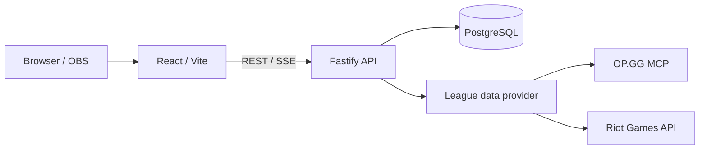

<div align="center">

# LP-Tracker

**Track League of Legends LP progression, events and player performance in one place.**

A self-hosted platform for competitive LP events, live leaderboards, player history and OBS overlays.


[**Documentation**](docs/index.md) **·** [**Installation**](docs/getting-started/installation.md) **·** [**Roadmap**](ROADMAP.md) **·** [**Contributing**](CONTRIBUTING.md)

</div>

---

## Overview

LP-Tracker tracks League of Legends players across scheduled LP events. It stores player, match and event data in PostgreSQL, calculates LP progression relative to event start snapshots and provides live standings to browsers and stream overlays.

### Highlights

* Live event leaderboards with LP gain, rank, win/loss record and recent matches
* Event scheduling, player management and persistent event history
* Player details, match observations and event-relative snapshots
* OP.GG MCP and Riot Games API integrations, including Riot rate-limit handling
* Server-Sent Events (SSE) for frontend updates
* OBS-ready player overlays and an overlay generator
* Admin tools, diagnostics, health checks and optional Prometheus metrics

For user-facing instructions, see the [User Guide](docs/user-guide/leaderboard.md) and [Administration Guide](docs/administration/overview.md). For scoring internals, see [Event System](docs/event-system/scoring.md).

## Architecture



The frontend is served as static files through Nginx; the backend owns API, database and provider access. In production, a reverse proxy normally exposes the frontend and `/api/\*` under the same origin.

See [System Architecture](docs/development/architecture.md) and [REST API \& Live Updates](docs/development/api.md).

## Deployment

**Requirements:** Docker Engine, PostgreSQL with persistent storage, a reverse proxy with HTTPS, and access to a supported data provider.

### Container images

|Environment|Frontend image|Backend image|
|-|-|-|
|Release|`safhdev/lp-tracker:frontend`|`safhdev/lp-tracker:backend`|
|Staging|`safhdev/lp-tracker:frontend-staging`|`safhdev/lp-tracker:backend-staging`|
|Main branch|`safhdev/lp-tracker:frontend-main`|`safhdev/lp-tracker:backend-main`|

Release image tags are published by the version-tag build in Woodpecker CI. Use matching frontend and backend builds. For reproducible production deployments, pin a release-specific image tag or digest.

```bash
docker pull safhdev/lp-tracker:frontend
docker pull safhdev/lp-tracker:backend
```

Expected service ports and routing:

```text
/           -> frontend:80
/api/\*      -> backend:3000
/metrics    -> backend:3000  (disabled unless METRICS\_TOKEN is configured)
```

These pull commands download the images; they do not by themselves configure or start a complete deployment. Follow the [Installation Guide](docs/getting-started/installation.md), [Configuration Guide](docs/getting-started/configuration.md) and [Deployment Guide](docs/operations/deployment.md) for database setup, secrets, startup and upgrades.

### Build from source

```bash
git clone https://github.com/Sysadminfromhell/LP-Tracker.git
cd LP-Tracker
docker build -f Dockerfile.backend -t lp-tracker-backend .
docker build -f Dockerfile.frontend -t lp-tracker-frontend .
```

For identifiable backend builds, pass `--build-arg GIT\_COMMIT\_SHA="$(git rev-parse HEAD)"` to the backend Docker build. The CI pipeline supplies the commit SHA automatically; manual builds without it may report `dev`.

## Local development

Install dependencies and configure the backend environment:

```bash
npm --prefix backend ci
npm --prefix frontend ci
cp backend/.env.example backend/.env
```

On Windows PowerShell, use `Copy-Item backend/.env.example backend/.env` instead. Set up PostgreSQL and the required variables from [`backend/.env.example`](backend/.env.example), then run these in separate terminals:

```bash
npm --prefix backend run dev
npm --prefix frontend run dev
```

The Vite dev server normally uses `http://localhost:5173` and proxies `/api` to the backend at `http://localhost:3000`.

See [Local Development](docs/development/local-development.md) for details and quality checks.

## Documentation

The maintained Markdown wiki lives in [`docs/`](docs/index.md) and is built with Zensical. Key sections:

|Topic|Guide|
|-|-|
|Installation and configuration|[Getting Started](docs/getting-started/installation.md)|
|Leaderboards, history and overlays|[User Guide](docs/user-guide/leaderboard.md)|
|Events and administration|[Administration](docs/administration/overview.md)|
|Scoring, snapshots and reconciliation|[Event System](docs/event-system/scoring.md)|
|Architecture, API and contributions|[Development](docs/development/architecture.md)|
|Providers, monitoring, diagnostics and recovery|[Operations](docs/operations/deployment.md)|

Application health is available at `GET /api/health`; detailed administrative health information requires authentication. The optional `GET /metrics` endpoint is protected by a Bearer token. For operational investigation, use the read-only [Diagnostics CLI](docs/operations/diagnostics.md) and [Troubleshooting Guide](docs/operations/troubleshooting.md).

## Project \& community

* [Roadmap](ROADMAP.md) — shipped milestones and planned features
* [Contributing](CONTRIBUTING.md) — development workflow and pull requests
* [Security Policy](SECURITY.md) — vulnerability reporting and deployment security
* [Issues](https://github.com/Sysadminfromhell/LP-Tracker/issues) — bugs and feature requests

## License

Copyright (C) 2026 Sysadminfromhell.

LP-Tracker is licensed under the [GNU Affero General Public License v3.0 only](LICENSE) (AGPL-3.0-only). Network deployment of modified versions has corresponding source-sharing obligations under the license; review the full license text for the applicable terms.

