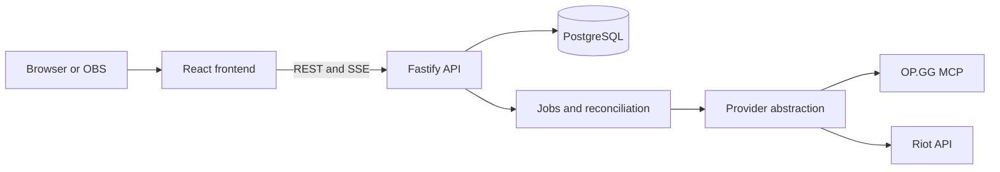

# System Architecture

LP-Tracker uses React/Vite on the frontend, a Node.js/Fastify backend, PostgreSQL and interchangeable League data providers.

## Repository layout

| Directory | Responsibility |
| --- | --- |
| `frontend/src/pages` | Public, admin, history and overlay screens |
| `backend/src/routes` | Fastify HTTP endpoints |
| `backend/src/services` | Domain logic, refreshing and live updates |
| `backend/src/db` | Database queries and migrations |
| `backend/src/providers` | Riot and OP.GG integrations |
| `backend/src/runtime` | Runtime coordination |
| `contracts` | Shared API contracts |

The backend owns database and provider access. Production traffic routes `/api/*` to the backend while the frontend is served from the same public origin.

Continue with [REST API & Live Updates](api.md).
